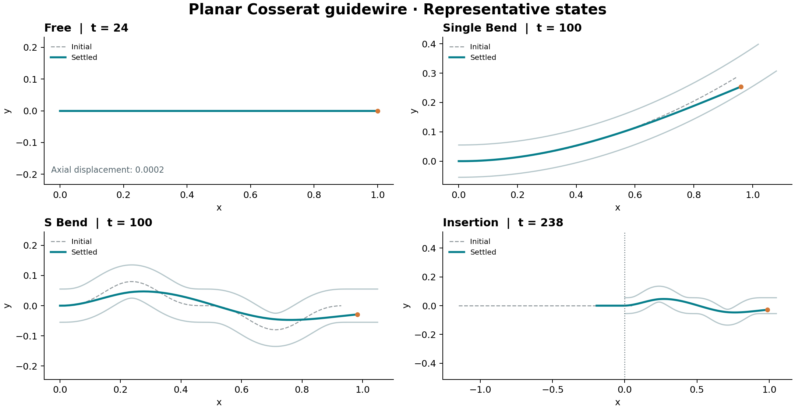

# 2D_CPF_Guidewire

A reproducible two-dimensional guidewire simulation built on a discrete Cosserat rod, frictionless normal penalty contact, and a fixed spatial entry guide. The mechanics backend is [PyElastica](https://github.com/GazzolaLab/PyElastica).

The repository provides four scenarios: free rod, single bend, S-bend, and insertion followed by a small proximal perturbation. Parameters use normalized model units.



Representative initial and settled states from the [preserved reference runs](reference/README.md); the figure does not certify transient convergence.

## Run

Install [uv](https://docs.astral.sh/uv/getting-started/installation/) and Git, then:

```sh
git clone https://github.com/HongqiongGUO/2D_CPF_Guidewire.git
cd 2D_CPF_Guidewire
uv sync --locked
uv run cpf2d run --config configs/free_rod.toml --output outputs/free_rod
uv run cpf2d render outputs/free_rod
```

Python 3.12.14 is pinned in `.python-version`. `uv` can provision it when needed. The first numerical run compiles Numba kernels and takes longer. Each run requires a new or empty output directory.

```sh
uv run cpf2d run --config configs/single_bend.toml --output outputs/single_bend
uv run cpf2d run --config configs/s_bend.toml --output outputs/s_bend
uv run cpf2d run --config configs/insertion.toml --output outputs/insertion
uv run pytest
uv run cpf2d validate --suite all --output outputs/validation
```

For a short installation check, add `--duration 0.2` to a run. For insertion this records only the beginning of the insertion ramp. It does not complete insertion, settling, or perturbation.

## Structure

```text
src/cpf2d/       geometry, rod, contact, boundary, simulation, recording, rendering
  validation/   cantilever, wall impact, lumen geometry, material feed
configs/        four physical scenarios
tests/          unit tests and numerical regression fixtures
reference/      compact expected results and fixture provenance
docs/           formulation, reproduction, validation scope and limitations
.github/        automated installation and validation checks
outputs/        generated locally; excluded from version control
```

## Validation scope

Canonical checks cover small-amplitude cantilever vibration, unilateral straight-wall impact, analytic lumen geometry, and material passage through a fixed entry. **These component checks do not establish timestep-converged dynamics for coupled S-bend insertion.** Settled shapes and qualitative behavior are useful; detailed transient contact timing remains unverified. See [validation](docs/validation.md) and [limitations](docs/limitations.md).

See [model](docs/model.md), [reproduction and output format](docs/reproduction.md), and [reference data](reference/README.md). The package and canonical tests run without access to any precomputed output files.
